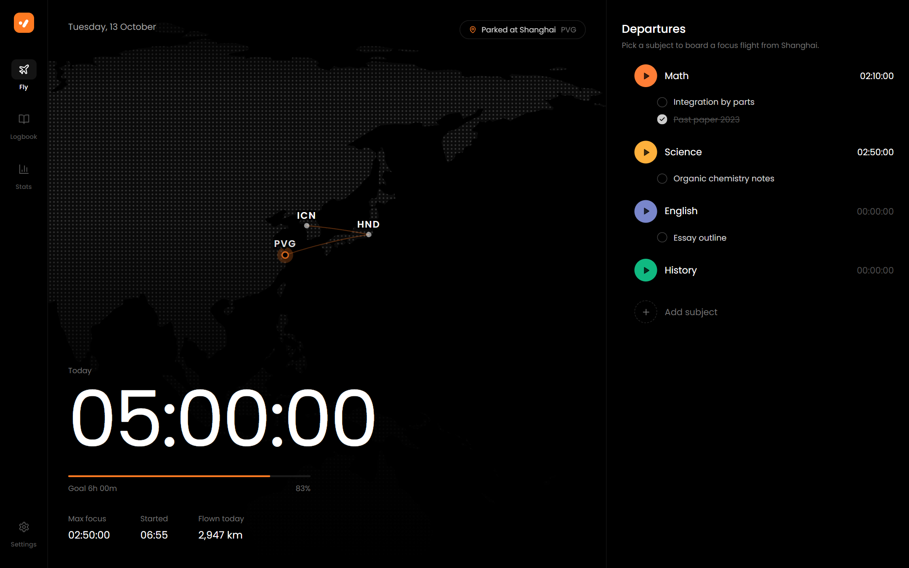
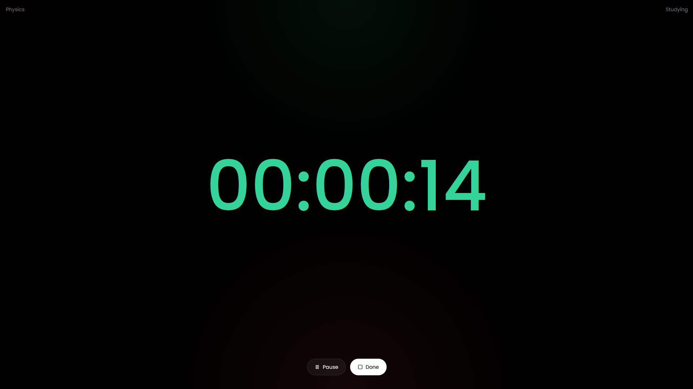

# PassionIndicator

A minimal dark study timer for the web. Recreation of Yeolpumta for Desktop, but very stripped down and minimal. The app keeps one main dashboard, a fullscreen study overlay, and a simple subject list. The interface uses Poppins everywhere and stays focused on time, not decoration.

<table>
  <tr>
    <td align="center">
       
      <b>Home Screen</b>
    </td>
    <td align="center">
       
      <b>Study Screen</b>
    </td>
  </tr>
</table>

## What it does
- The dashboard shows study time and subjects. 
- Each subject can be started, renamed, or deleted, and choose different beautiful colors too!
- Starting a subject opens a fullscreen timer view with a clear green state while studying and a red state while on break.
- Leaving fullscreen or switching tabs automatically puts you on break, just like locking your phone in Yeolpumta.
- Press Space in the study screen to pause or resume.
- Saves your progress too!
- It also has pomodoro mode! So choose whatever you like to use <3
