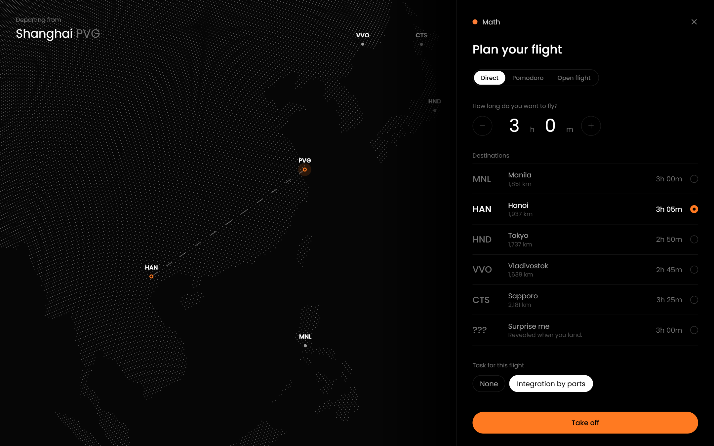
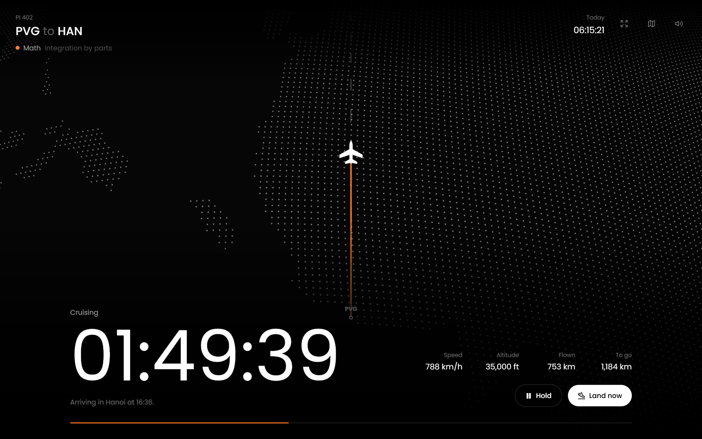
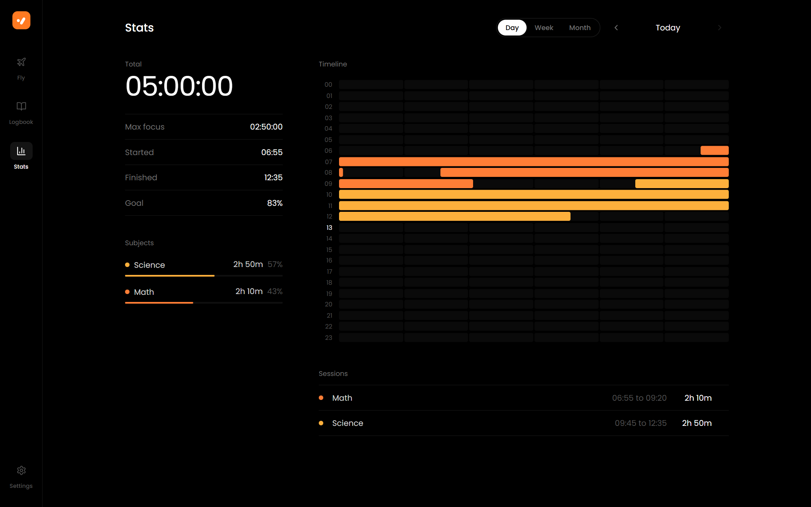

# PassionIndicator

A minimal, pure black study timer for desktop. It brings Yeolpumta to the PC and turns every study session into a flight across a 3D globe, so the time you spend focused feels like a journey.

<table>
  <tr>
    <td align="center">
       
      <b>Home</b>
    </td>
    <td align="center">
       
      <b>Choosing a flight</b>
    </td>
  </tr>
  <tr>
    <td align="center">
       
      <b>Flying on the 3D globe</b>
    </td>
    <td align="center">
       
      <b>Stats</b>
    </td>
  </tr>
</table>

## What it does
PassionIndicator mixes three apps: the flight metaphor of FocusFlight, the pomodoro rhythm of Pomofocus and the study tracking of Yeolpumta.

- Every study session is a flight. Pick a subject, type how long you want to fly and choose from real routes with realistic flight times.
- While you focus, your plane taxis, climbs, cruises and descends over a dotted 3D globe while a chase camera follows it, with live speed and altitude. A flat map is there too if you prefer it.
- Need a break? Press Hold and the flight circles in a holding pattern until you resume. Switching tabs never pauses it, so lectures in another tab are fine.
- Three ways to fly: direct flights, pomodoro legs that hop from city to city with layovers, and open flights that run like a stopwatch.
- Land early and you touch down at the nearest airport. Your plane stays where it landed, so the next flight departs from there.
- A calm cabin or rain ambience plays while you fly.
- The logbook keeps a map of your routes and every flight you have taken.
- Yeolpumta style stats for each day, week and month, with a timeline planner, focus bars, a calendar heatmap, max focus and streaks.
- Distances in km, mi or nm and speeds in km/h, mph or kts.
- Everything stays in your browser. Export, import or erase your data from Settings. Installable as a desktop app and works offline.

## Map data
The world map is generated from Natural Earth via world-atlas. Run `node scripts/gen-world-dots.mjs` to rebuild `src/data/worldDots.ts`.
